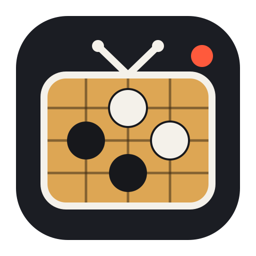
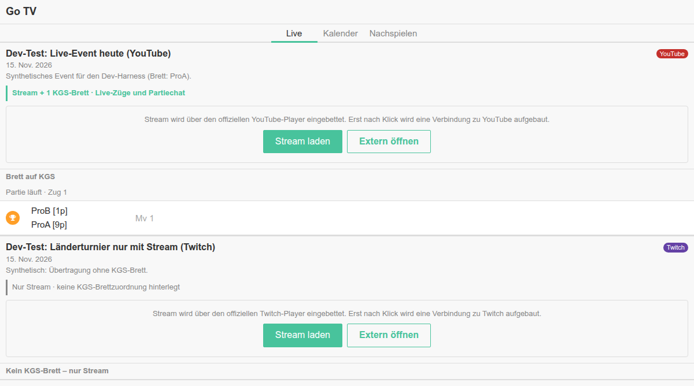
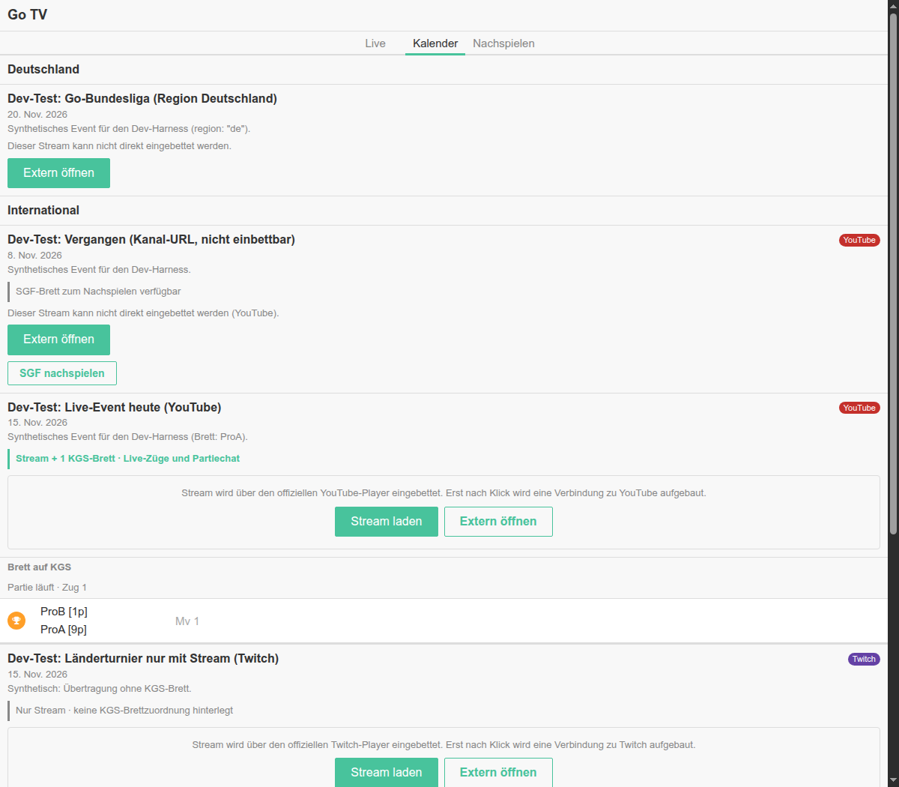
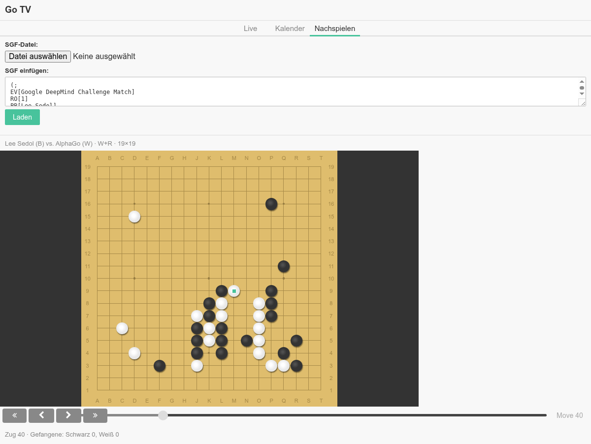

<p align="center">
  
</p>

<h1 align="center">GoTV</h1>

GoTV is a Go TV app: live Go broadcasts with the game board next to the
stream, a tournament calendar, Go channels, and game replay with KataGo
analysis. It runs in the browser, on a tablet, and as a desktop app on Linux,
and it is also a full client for the [KGS Go Server](http://www.gokgs.com/).

<p align="center">
  <a href="https://ajiai-labs.github.io/GoTV/"><b>▶ Open GoTV in your browser</b></a><br>
  <sub>No installation - works on desktop, tablet and phone, and offline for games you
  have opened. Everything except KGS boards and the KGS login; for those, install the
  <a href="#quick-start-gotv-on-your-linux-desktop">desktop app</a>.</sub>
</p>

**New interface:** GoTV has been rebuilt with Svelte 5 + TypeScript, with two
designs to choose from, "Modern" and "Oldschool". The desktop app already uses it;
the web version shows it under https://ajiai-labs.github.io/GoTV/neu/ until the
switch-over - plan and status in [`docs/umbau-svelte.md`](docs/umbau-svelte.md).

## What GoTV does

- **Live:** tournaments that are running right now - with the official
  YouTube/Twitch player where a stream exists, and with the game boards
  next to it. Tournaments without a stream are listed by their boards.
- **Boards from KGS and OGS:** KGS broadcast games (after login) and games
  on [online-go.com](https://online-go.com) (no account needed). OGS moves,
  clocks and chat arrive in real time; each board is labelled KGS or OGS.
- **Follows a match by itself:** name the OGS players of an event, or paste
  one OGS game link at the card ("OGS-Partielink zuordnen") - after each
  game the next game of the same players appears automatically.
- **Several boards at once:** a team match shows small live boards with
  players, ranks and move number; a click brings one up next to the stream.
- **Kinomodus:** stream and board fill the window side by side, with an
  adjustable split and a collapsible chat.
- **Brett-Verzögerung:** delay the boards by 0-120 s (slider or ±5 s
  buttons) so moves never get ahead of the video commentary; GoTV
  remembers the delay per channel.
- **Watch without a KGS login:** "Go TV ohne Anmeldung ansehen" on the
  login screen, or open `/tv` directly.
- **Kalender** and **Nachspielen:** a tournament calendar that refreshes
  daily (DGoB, EGF Grand Prix, the EGF Twitch schedule and the Speed Go
  Championship bracket, whose OGS games are linked automatically), and SGF
  replay move by move - including the finished OGS games of tournaments
  from the last three months.
- **In any browser, also on a tablet:** https://ajiai-labs.github.io/GoTV/
  (open it and choose "Add to home screen"). This web version has
  everything except KGS boards, KGS chat and the KGS login - KGS answers
  only its own website; for those, use the desktop app below.
- **Whole-game review:** "Ganze Partie auswerten" draws the win-chance
  curve of the game and lists the game-deciding mistakes, checked with a
  KataGo search; a click jumps to the position before the mistake.
- **KataGo analysis in the browser:** while replaying, switch on
  "KataGo-Analyse" for the win chance, the score and KataGo's five best
  moves on the board, and how the game's move compares ("Die Partie
  spielte F3: laut KataGo 1,2 Punkte schlechter als C17"). It runs on
  WebGPU or WASM on any device, without a server; a stronger network can
  be loaded from disk. Engine: [Web KaTrain](https://github.com/Sir-Teo/web-katrain)
  (MIT), see `public/katago/NOTICE.txt`.
- **Nachspielen, your way:** click the board to try your own moves (a side
  line; "Zurück zur Partie" returns), lay KataGo's expected line as a
  variation ("Variante legen") and step through it, switch between game
  and variations where they part, delete a variation, keep variations
  for next time and save everything as an SGF file ("Als SGF speichern"), continue a game where you stopped,
  and set bookmarks with a note. The result stays hidden until the game's
  last move.
- **Offline on the tablet:** the web version keeps itself and KataGo on the
  device. Without a connection you can still open it, replay games you
  have opened before (also tournament games) and analyse them with KataGo.
- **Meine Daten:** save stars, replays (with bookmarks and variations) and
  settings as one file and load it on another device - desktop to tablet
  and back. Loading only adds; nothing already there is deleted.
- **Mein GoTV:** star channels and tournaments (☆). Starred channels sit at
  the top of the Kanäle tab; at the top of Live, "Mein GoTV" lists what is
  on now and what comes next, with an optional browser reminder ten
  minutes before (while GoTV is open). Stars stay in this browser.
- **Kanäle:** internet channels of players (e.g. JuppTube) and of
  federations and tournaments, kept apart from the tournament calendar.
  A channel with fixed weekly air times shows them, is marked "läuft
  gerade (geplant)" while one runs, and is then also named under Live.
  A week plan shows all fixed air times; each channel links straight to
  its live page on YouTube/Twitch (chat, likes), and Twitch chats can be
  opened inside GoTV.

Streams are embedded only through the official players, and only after a
click (two-click solution).

## Screenshots

**Live** — running tournaments with the official video embed and their KGS/OGS boards:



**Kalender** — upcoming and recent tournaments as a month sheet or grouped by region:



**Nachspielen** — load any SGF (file, paste, or a bundled demo) and step through it move by move:



## KGS client

Logged in to KGS, GoTV is a complete KGS client: game lists, watching games with
chat, room chat, direct messages, user details, challenges (create, propose,
negotiate) and playing. Not yet available: automatch, rengo/simul and
admin tools.

## New interface (Svelte 5)

The old app (React, in the repository root) keeps running until the switch-over;
the new one in [`app/`](app/) does everything it did - including on the iPad and in
the desktop app. Phases:

- [x] Phase 0 - new app set up (SvelteKit, TypeScript, Vite, tests also in WebKit)
- [x] Phase 1 - all logic moved to TypeScript
- [x] Phase 2a - two designs, "Modern" and "Oldschool", switchable in the settings:
  draft online at https://ajiai-labs.github.io/GoTV/neu/ (sample data, approved)
- [x] Phase 2b - KGS core in the new design (login, Beobachten, Chat, Suche, profiles)
- [x] Phase 3 - playing (challenges, own games, scoring)
- [x] Phase 4 - GoTV parts (Live, Kalender, Kanäle, Nachspielen with KataGo, Mein GoTV,
  Meine Daten, offline web version)
- [x] Phase 5 - desktop app builds the new interface (`sh desktop/install.sh --alt`
  still installs the old one)
- [ ] Phase 6 - switch the web version over and remove the old app (needs the
  maintainer's go-ahead)

Details: [`docs/umbau-svelte.md`](docs/umbau-svelte.md), developer notes:
[`app/README.md`](app/README.md).

## Contributing

Pull requests are welcome at [ajiai-labs/GoTV](https://github.com/ajiai-labs/GoTV).
The easiest start is a calendar entry or a channel in `public/tv/events.json` - see
"Events eintragen" below. Every pull request runs the full CI (lint, Flow, tests,
build, and the new app's tests in Chromium and WebKit).

## Desktop-Installation (Linux, GNOME)

**Linux only** (tested on Ubuntu/GNOME); on other systems use the
[web version](https://ajiai-labs.github.io/GoTV/). GoTV can be installed
as a local desktop app: a Go-board-themed icon in the app grid opens the
login screen in its own window (no browser chrome).

Prerequisites:

- Node.js + Yarn V1 (see `AGENTS.md` "Setup")
- Python 3 (standard library only), `curl`
- A Chromium-family browser (chromium, google-chrome, brave or
  microsoft-edge; native, Flatpak or Snap are all detected automatically)
- `inkscape` or ImageMagick (`convert`/`magick`), only if you need to
  regenerate `desktop/icons/png/` from `desktop/icons/gotv.svg` - the
  rendered PNGs are committed, so a plain install doesn't need either

### Quick start: GoTV on your Linux desktop


You need Node.js 18 or newer, Python 3 and yarn. Get yarn with
`corepack enable` (part of Node.js) or `npm install -g yarn`. **Do not**
install the `cmdtest` package that Ubuntu suggests when `yarn` is
missing - it is a different program with the same command name.

```bash
git clone https://github.com/ajiai-labs/GoTV.git
cd GoTV
yarn install
sh desktop/install.sh
```

That installs the app for your user only (no sudo). Open the app grid
(Super key), type "GoTV" and start it. Right-click the icon in the dock
and choose "Pin to Dash" / "Zu Favoriten hinzufügen" to keep it there.

The icon comes from `desktop/icons/gotv.svg`; the rendered sizes are in
`desktop/icons/png/`.

### Icon on the desktop itself

To start GoTV from an icon on the desktop surface, copy the installed
launcher there and allow it to run:

```
cp ~/.local/share/applications/gotv.desktop "$(xdg-user-dir DESKTOP)/"
chmod +x "$(xdg-user-dir DESKTOP)/gotv.desktop"
gio set "$(xdg-user-dir DESKTOP)/gotv.desktop" metadata::trusted true
```

The last line does the same as right-click → "Allow Launching" /
"Starten erlauben". Desktop icons need a desktop that shows them: Ubuntu
does out of the box (Desktop Icons NG); plain GNOME does not - use the
app grid or the dock there. Run `sh desktop/install.sh` first, the
launcher file does not exist before.

### Details

Install (no sudo, user-scoped only):

```
sh desktop/install.sh
```

Then launch "GoTV" from the app grid. The installer builds the new interface
(`app/`, `VITE_API_URL=/json/access`); `sh desktop/install.sh --alt` builds the
old React interface instead, until it is removed. The app serves the production
build from `build-desktop/` on `127.0.0.1:8788` only; KGS traffic is proxied
through the local server at `/json/access` (KGS only allows a whitelist
of CORS origins, so direct browser access from localhost is rejected).

Uninstall:

```
sh desktop/uninstall.sh
```

Browser profile and server log live in `~/.local/share/gotv/` and are left
in place by the uninstaller.

### Fehlerbehebung

- **Icon fehlt in der App-Auswahl:** `sh desktop/install.sh` erneut
  ausführen, dann `gtk-update-icon-cache -f -t ~/.local/share/icons/hicolor`
  (macht `install.sh` bereits selbst, falls vorhanden) - hilft das nicht,
  einmal ab- und wieder anmelden (manche Desktop-Umgebungen aktualisieren
  die Icon-Auswahl sonst nicht sofort).
- **Desktop-App zeigt einen alten Stand:** `sh desktop/install.sh` erneut
  ausführen - baut `build-desktop/` neu und aktualisiert Icon/Launcher.

## Events eintragen

The GoTV calendar (`public/tv/events.json`) is loaded from
[`ajiai-labs/GoTV`](https://github.com/ajiai-labs/GoTV) on
GitHub first, falling back to the bundled local copy when offline or
unreachable (`fetchTvEvents()` in `src/model/tv.js`, cached for an hour).
To add or update an event, edit `public/tv/events.json` in this repo and
open a pull request.

Each entry:

| Field | Required | Description |
|---|---|---|
| `id` | yes | Stable, unique string (used as the React key). |
| `name` | yes | Event name shown in the calendar. |
| `date_start` | yes | `YYYY-MM-DD`. The event is "live" from the start of this day. |
| `date_end` | no | `YYYY-MM-DD`. Defaults to `date_start` for single-day events. |
| `platform` | yes | `"youtube"`, `"twitch"`, or `"other"` (link only, no embed). |
| `stream_url` | yes | Channel or video page; used for "Extern öffnen" and as a fallback embed source. |
| `video_id` | no | A specific YouTube or Twitch video id - embeds that exact recording and wins over everything else. |
| `channel` | no | `{"platform": "youtube"\|"twitch", "id": "..."}`. Used only while the event is live (today) and no `video_id` is set, to embed whatever that channel is currently streaming. YouTube needs the channel *id* (`UC...`), not the `@handle`; Twitch takes the channel login. |
| `sgf_url` | no | Link to a recorded SGF. Shows a "SGF nachspielen" shortcut and keeps the event from disappearing after 14 days (see below). |
| `notes` | no | Short free-text shown under the name. |
| `start` | no | Exact start time (ISO 8601 with offset). The event then counts as live from 15 minutes before until `duration_minutes` after (default 240). |
| `kgs_room` / `kgs_players` | no | KGS room name and/or KGS player names whose broadcast games belong to this event. |
| `ogs_game_id` | no | Number of one game on online-go.com (`https://online-go.com/game/<id>`) to show as the board. |
| `ogs_players` | no | OGS user names of the players. The board is the game between exactly these players that started during the event; a series moves on to the next game by itself. |
| `ogs_game_ids` | no | Numbers of finished OGS games of this event (e.g. from the tournament page), for replay when the players' OGS names are unknown. |

Finished OGS games of an event (`ogs_game_ids`, or found through
`ogs_players`) can be replayed: "Partien nachspielen" on the card, and
"Turnierpartien der letzten 3 Monate" in the Nachspielen tab. The list
shows players and start time only - no results, nothing is spoiled.

An event appears under **Live** while it runs and there is something to
watch: a YouTube/Twitch stream, a linked board (`kgs_*`/`ogs_*`), or both.
An event with neither stays in the calendar only.

Example entry for a tournament broadcast on a known channel, embedding
whatever that channel streams while the event is live:

```json
{
  "id": "example-cup-2027",
  "name": "Example Cup 2027",
  "date_start": "2027-03-01",
  "date_end": "2027-03-03",
  "platform": "youtube",
  "stream_url": "https://www.youtube.com/@ExampleGoChannel",
  "channel": { "platform": "youtube", "id": "UCxxxxxxxxxxxxxxxxxxxxxx" },
  "notes": "Example only - replace with a real, confirmed broadcast."
}
```

Past events are shown for 14 days after they end, then dropped from the
calendar - unless they have a `video_id` or `sgf_url`, in which case they
move to an "Archiv" section instead of disappearing.

### Kanäle eintragen

Alongside the date-bound events above, `public/tv/events.json` has a
second, standing list: `channels`. A channel has no event date - it
always shows up in the "Kanäle" tab, apart from the tournament calendar:
players' channels under "Spieler", the rest under "Verbände und
Turniere".

Each entry:

| Field | Required | Description |
|---|---|---|
| `id` | yes | Stable, unique string (used as the React key). |
| `name` | yes | Channel name shown in the Kanäle tab. |
| `platform` | yes | `"youtube"` or `"twitch"` (no `"other"` - both need a known, official embed shape). |
| `url` | yes | The channel's page; used for "Extern öffnen" and as the starting point to find a YouTube `channel_id` (see below). |
| `channel_id` | yes | YouTube: the `UC...` channel id, *not* the `@handle`. Twitch: the channel login (the last path segment of its URL). |
| `notes` | no | Short free-text shown under the name. |
| `kind` | no | `"player"` for a player's own channel; `"organization"` (the default) for federations and tournaments. |
| `schedule` | no | Fixed weekly air times in German time (Europe/Berlin): a list of `{"weekday": 1-7 (1 = Monday, 7 = Sunday), "time": "HH:MM", "duration_minutes": 120}`; `duration_minutes` defaults to 120. While one runs, the card says "läuft gerade (geplant)" and Live names the channel. |

Example entry:

```json
{
  "id": "example-channel",
  "name": "Example Go Channel",
  "platform": "youtube",
  "url": "https://www.youtube.com/@ExampleGoChannel",
  "channel_id": "UCxxxxxxxxxxxxxxxxxxxxxx",
  "notes": "Example only - replace with a real channel.",
  "kind": "player",
  "schedule": [{ "weekday": 7, "time": "10:30", "duration_minutes": 150 }]
}
```

Finding a YouTube channel's `UC...` id from its `@handle` URL: open
the channel page, view its page source (`Strg`+`U` in the browser, or
`curl <url>`), and search for `"externalId"` - the value right after
it is the channel id. A Twitch `channel_id` needs no lookup: it's
just the channel's login, the last segment of `twitch.tv/<login>`.

Each channel entry always tries to embed the channel's current live
stream (`youtube-nocookie.com/embed/live_stream?channel=...` /
`player.twitch.tv/?channel=...` - the same official embeds Events use
for their `channel` field). There is no way to know in advance,
without an API key, whether a channel is actually broadcasting right
now; if it isn't, the official player itself shows its own "offline"
state once loaded ("Gerade keine Übertragung"), and "Extern öffnen"
stays available either way. A `schedule` is therefore a plan, not a
live check - hence "(geplant)".

## Code Overview

The current app (repository root) uses JavaScript, React, and ES6+ with [Flow](https://flow.org/) types. [VS Code](https://code.visualstudio.com/) (with eslint and flow extensions added) is a great editor for this setup.

State is managed with a Redux-like pattern: there is a single, primary source of truth for app state, plus a bit of component-local state. Messages describing actions are dispatched, which handlers then process to produce the next app state. Unlike typical Redux, no implicit context is used. Everything is passed down through props.

The new interface in [`app/`](app/) uses Svelte 5, SvelteKit (static, no server),
TypeScript and Vite; its logic (`app/src/lib/model`, `app/src/lib/util`) is the same
as in `src/model` and `src/util`, moved to TypeScript.

## Development Setup

You'll need [Node.js](https://nodejs.org/en/) 24 and Yarn 1 (via corepack:
`corepack enable`).

```
yarn install
yarn start            # dev server on port 3000 (PORT=3100 yarn start for another port)
```

Requests go to the official KGS API and are proxied through the development
server. `yarn start:beta` uses the KGS beta server instead (HTTPS with a
self-signed certificate; accounts at https://beta.gokgs.com/register/index.html).

Before pushing, the same checks as the CI:

```
yarn lint && yarn flow && CI=true yarn build
CI=true yarn test --watchAll=false --testPathPattern="src/(model|util|ui)"
python3 -m unittest tools.test_update_events tools.test_check_links tools.test_refresh_tv_events tools.test_speedgo
```

The new interface has its own commands, see [`app/README.md`](app/README.md).

## Deployment

- **Web version:** every push to `master` runs the CI (`.github/workflows/ci.yml`)
  and publishes https://ajiai-labs.github.io/GoTV/ (guest TV, `yarn build:pages`)
  plus the preview of the new interface under `/GoTV/neu/`.
- **Calendar data:** a daily workflow imports new events into
  `public/tv/events.json`; the web version loads that file at runtime.
- **Desktop app:** `desktop/install.sh` builds and installs it locally (see above).

## References

* [KGS API Docs](https://www.gokgs.com/json/protocol.html)
* [KGS API Download](https://www.gokgs.com/help/protocol.html)
* [KGS Client Coding Google Group](https://groups.google.com/forum/#!forum/kgs-client-coding)

## Similar Projects

* [Go Universe](https://github.com/IlyaKirillov/GoUniverse)
* [KGS Leben](https://github.com/stephenmartindale/kgs-leben)

## Origin and license

GoTV is an independent project. It started from the code of
[jkk/shinkgs](https://github.com/jkk/shinkgs) (Shin KGS by Justin Kramer, no longer
maintained since 2023); that code stays under its MIT license, see `LICENSE.txt`.
GoTV is not the official Shin KGS client, it is not operated by or affiliated with
KGS Go Server, and it uses no KGS logos or trademarks.
