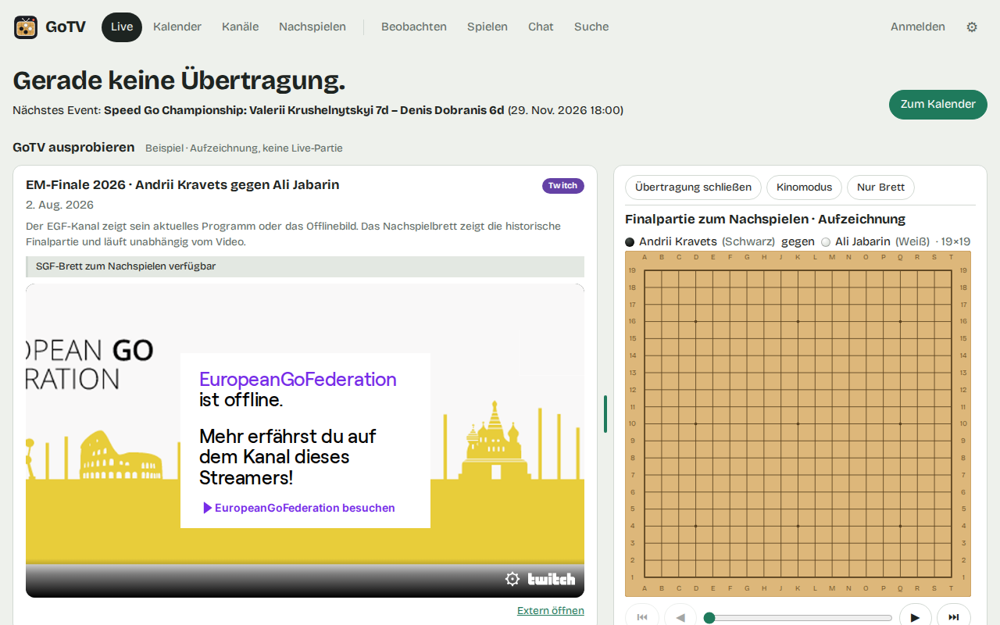
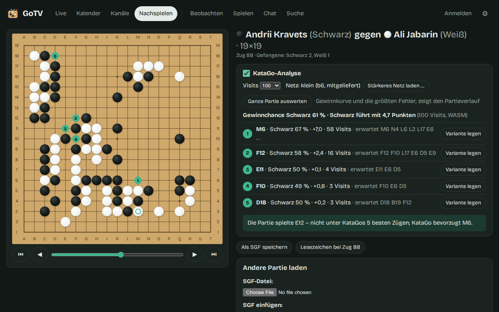
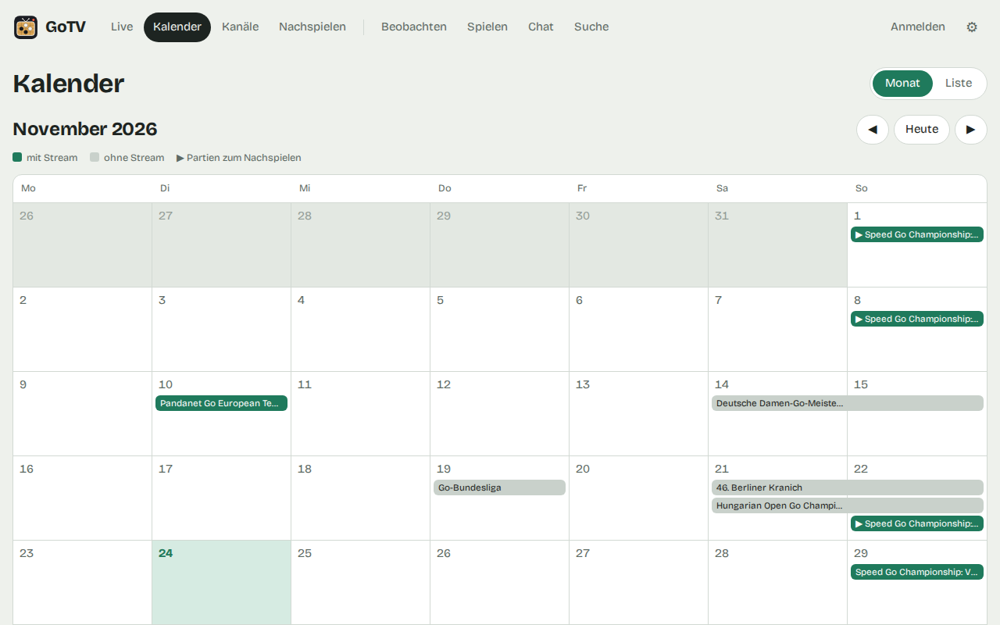
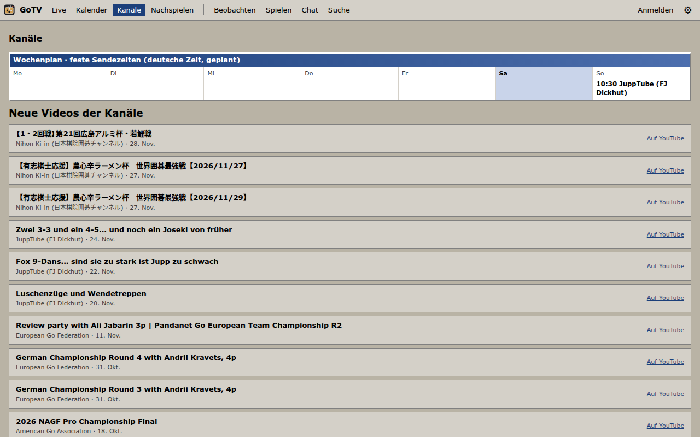
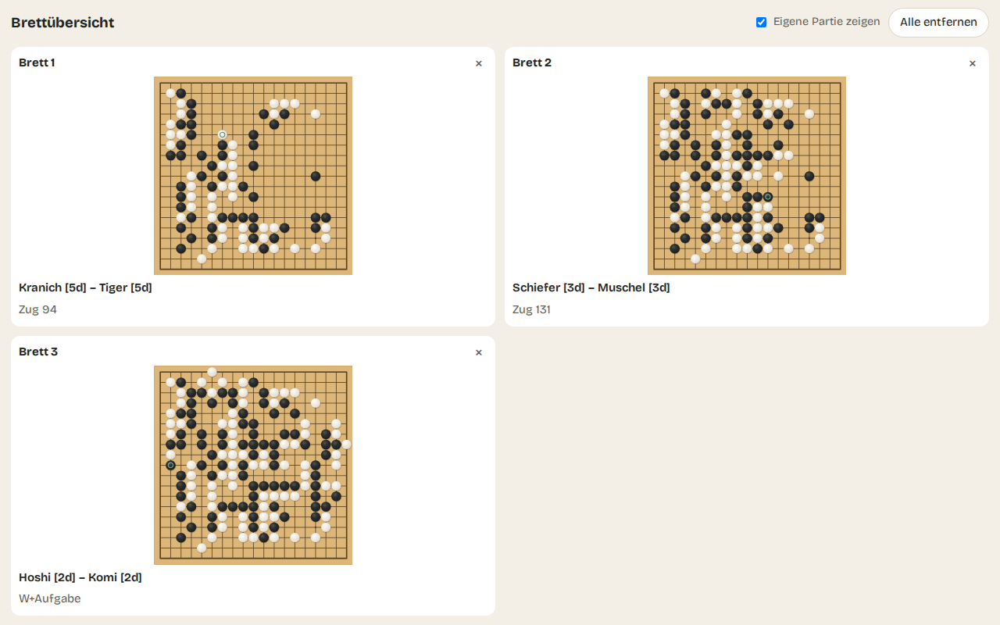
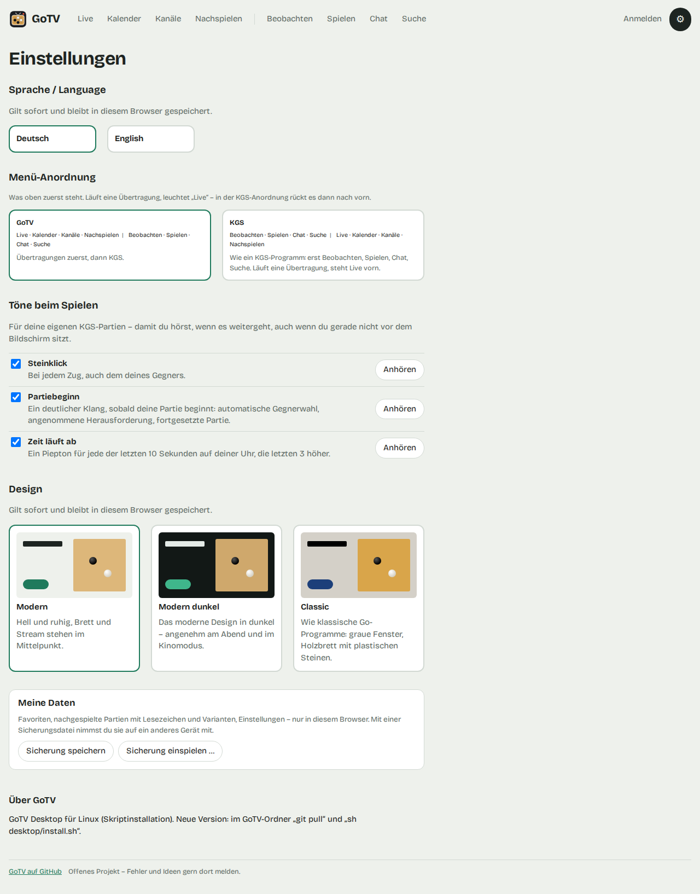

<p align="center">
  
</p>

<h1 align="center">GoTV</h1>

GoTV is a Go TV app: live Go broadcasts with the game board next to the
stream, a tournament calendar, Go channels, and game replay with KataGo
analysis. It runs in the browser, on a tablet, and as a desktop app on Linux,
and it is also a full client for the [KGS Go Server](http://www.gokgs.com/).

<p align="center">
  <a href="https://ajiai-labs.github.io/GoTV/"><b>▶ Open GoTV in your browser</b></a>
  &nbsp;·&nbsp;
  <a href="#download-the-desktop-app"><b>⬇ Download the desktop app</b></a><br>
  <sub>The browser version needs no installation and works on desktop, tablet and phone,
  offline too for games you have opened - everything except KGS, which only answers its
  own website. The desktop app for Windows, macOS and Linux adds KGS: watching,
  playing, chat.</sub>
</p>

## Download the desktop app

| System | Download |
|---|---|
| Windows | [Installer (.exe)](https://github.com/ajiai-labs/GoTV/releases/latest/download/GoTV-windows-x64-setup.exe) · [.msi](https://github.com/ajiai-labs/GoTV/releases/latest/download/GoTV-windows-x64.msi) |
| macOS (Apple Silicon and Intel) | [.dmg](https://github.com/ajiai-labs/GoTV/releases/latest/download/GoTV-macos-universal.dmg) |
| Linux | [AppImage](https://github.com/ajiai-labs/GoTV/releases/latest/download/GoTV-linux-x86_64.AppImage) · [.deb](https://github.com/ajiai-labs/GoTV/releases/latest/download/GoTV-linux-amd64.deb) |

The apps are free and not signed, so Windows and macOS warn on the first start - how
to open them: [`desktop/tauri/README.md`](desktop/tauri/README.md). All versions:
[Releases](https://github.com/ajiai-labs/GoTV/releases). iPad and iPhone: use the
browser version and "Add to Home Screen" (Apple allows no apps outside the App
Store). On Linux the script install below works as well.

**Three designs:** "Modern", "Modern dunkel" (dark) and "Classic", switchable in the
settings. GoTV is built with Svelte 5 + TypeScript (`app/`).

**Desktop downloads and updates:** the files above always point to the latest
release. A new release is built only when a version tag `desktop-vX.Y.Z` is pushed
(`.github/workflows/desktop.yml`), so the desktop apps can be behind the browser
version, which updates with every change on `master`. From version 0.3.0 the desktop
app says at start when a newer version is out ("Update herunterladen" opens the
download); "Einstellungen → Über GoTV" shows the version and checks by hand.

## What GoTV does

- **Live:** tournaments that are running right now - with the official
  YouTube/Twitch player where a stream exists, and with the game boards
  next to it. Tournaments without a stream are listed by their boards.
- **Boards from KGS and OGS:** KGS broadcast games (after login) and games
  on [online-go.com](https://online-go.com) (no account needed). OGS moves,
  clocks and chat arrive in real time; each board is labelled KGS or OGS.
- **Follows a match by itself:** name the OGS players of an event, or paste
  one OGS game link at the card ("OGS-Partielink zuordnen") - after each
  game the next game of the same players appears automatically. For the
  Speed Go Championship GoTV knows the players' OGS accounts, so the board
  appears next to the stream as soon as a game starts.
- **Several boards at once:** a team match shows small live boards with
  players, ranks and move number; a click brings one up next to the stream.
- **Jetzt auf KGS:** running KGS tournament games and games KGS broadcasts appear
  on Live grouped by room - also without a calendar entry or stream; a room's games
  go to the board overview with one click.
- **Kinomodus:** stream and board fill the window side by side, with an
  adjustable split and a collapsible chat. The split between stream and board
  can be dragged in the normal view too.
- **Brett-Verzögerung:** delay the boards by 0-120 s (slider or ±5 s
  buttons) so moves never get ahead of the video commentary; GoTV
  remembers the delay per channel.
- **Watch without a KGS login:** Live, Kalender, Kanäle and Nachspielen work
  without an account; KGS (Beobachten, Spielen, Chat) asks for the login.
- **Playing on KGS:** challenges, your own games with clocks, undo, scoring -
  and, new in GoTV, **automatic opponent selection** ("Automatische Gegnerwahl",
  as in CGoban: humans/bots, ranked/free, speed, max. rank difference). Resigning
  asks once more, so a mistaken tap on the tablet does not end the game. The
  edge between board and side column can be dragged to make the board bigger.
  While a board is open (own game, watching, replay) the menu bar is hidden, as
  in a separate game window; the small GoTV logo leads back. Leaving your own
  running game asks first: back to the game, resign or leave.
- **Games in their own windows, as in CGoban:** a clicked game opens in a window of
  its own (an open one comes to the front); the main window keeps lists and chats.
  Your own game opens in its own window too, also when it starts by itself
  (automatch, accepted challenge). All windows share one KGS connection - a second
  tab says where KGS runs. The board grows with the window, as in CGoban.
- **Brettübersicht (board overview, team matches):** up to six games in one calm
  window apart from your own game - see [below](#brettübersicht-board-overview).
- **Stones like a real set:** white like clam shell (muted ivory with fine
  growth lines, every stone different), black like matte slate; white is
  drawn 2 % smaller, as in real Go sets, because light stones look bigger.
- **Watching, as in CGoban:** "Ergebnis schätzen" (score estimate - random
  playouts together with the influence of the stones, no AI; territory shown as
  small stones as in CGoban; wherever a game is open - watched games, the board
  overview, TV boards, reviews, Nachspielen - but never in your own running game),
  "Lokal betrachten" (a copy to step through on your own; KataGo stays off while
  the game runs on KGS) and "Spiel kopieren in …" (into one of your rooms).
- **Finding a game to watch:** Beobachten lists the games in columns - players,
  move, observers, board and time ("19×19 · 30 Min. + 5×30 Sek. · Japanisch") -
  with a search for players and rooms, filters for board size, pace and tournament
  games, and sorting by strength, observers or "just started". The room is shown
  for tournament games.
- **The clock:** big digits, red once the main time is over (byo-yomi), a green bar
  on the player to move.
- **Sounds while playing:** a stone click on every move, a sound when your game
  starts, a tick for each of the last 10 seconds on your clock and a sound for a
  chat message to you - so you hear it away from the screen. Each comes in four
  variants (e.g. stone on a kaya, thick or table board; gong, singing bowl, bass
  pulse) and can be switched off in the settings.
- **Designs:** Modern and Classic, each light and dark, in five background tones
  (warm paper, yellow, red, blue, green) - chosen in the settings.
- **Changed challenge terms:** if the challenge's creator answers with other
  terms, GoTV shows them with the changes highlighted to accept or decline.
- **Unfinished and archived games:** all unfinished games of yours are listed
  as in CGoban, games whose opponent is waiting first and in bold; "Partie
  fortsetzen" loads one into a room. A finished game from a player's archive
  opens in Nachspielen ("In GoTV nachspielen") with KataGo, or as a KGS review
  ("Partie laden"); "SGF herunterladen" saves the file from the KGS archive,
  and "Spiel kommentieren" gives it a short comment, listed under
  "Kommentierte Spiele" in the profile.
- **KGS reviews as in CGoban:** whoever has the control places stones,
  variations and marks (triangle, square, circle, cross, letters) and moves
  through the game for everyone in the review; the owner gives the control to
  someone else, takes it back and saves the review in the KGS archive. After
  your own game, "Mit Gegner besprechen" turns it into a review with your
  opponent.
- **KGS community:** friends, ignore and fan lists, messages for offline
  players and your mailbox, "Keine Unterhaltungen" (decline private chats),
  creating a room and the KGS server statistics. A player's rank graph shows the
  daily ups and downs with a line for every rank, as in CGoban.
- **Follow KGS players:** "Folgen" in a player's profile; "Gefolgte Spieler"
  shows who plays right now with a link to the game, and GoTV notifies you
  when one starts a game (while GoTV is open). Favourite KGS rooms are joined
  automatically after login.
- **After your own game:** "Mit KataGo auswerten" opens it in Nachspielen with
  KataGo on - only once the game is over, never during a game.
- **Share a game:** "Link kopieren" in Nachspielen gives a link that opens the
  same game at the same move in the browser version.
- **German and English:** the language follows the browser and can be switched
  in the settings.
- **Kalender** and **Nachspielen:** a tournament calendar that refreshes
  daily (DGoB, EGF Grand Prix, the Twitch schedules of the EGF, the AGA and
  Yunguseng Dojang, and the Speed Go Championship bracket, whose OGS games are
  linked automatically), and SGF replay move by move - including the finished OGS
  games of tournaments from the last three months. A finished Grand Prix
  tournament names its winner - only on request, so replaying spoils nothing.
- **Tournament archive:** "Alle Partien herunterladen (ZIP)" saves all finished
  OGS games of a calendar tournament as SGF files with a list of the games.
- **In any browser, also on a tablet:** https://ajiai-labs.github.io/GoTV/
  (open it and choose "Add to home screen"). This web version has
  everything except KGS boards, KGS chat and the KGS login - KGS answers
  only its own website; for those, use the desktop app below.
- **Whole-game review:** "Ganze Partie auswerten" draws the win-chance
  curve of the game and lists the game-deciding mistakes, checked with a
  KataGo search; a click jumps to the position before the mistake.
- **KataGo analysis in the browser:** while replaying, switch on
  "KataGo-Analyse" for the win chance, the score and KataGo's five best
  moves on the board, and how the game's move compares ("Die Partie
  spielte F3: laut KataGo 1,2 Punkte schlechter als C17"). It runs on
  WebGPU or WASM on any device, without a server; a stronger network can
  be loaded from disk. Engine: [Web KaTrain](https://github.com/Sir-Teo/web-katrain)
  (MIT), see `public/katago/NOTICE.txt`.
- **Nachspielen, your way:** click the board to try your own moves (a side
  line; "Zurück zur Partie" returns), lay KataGo's expected line as a
  variation ("Variante legen") and step through it, switch between game
  and variations where they part, delete a variation, keep variations
  for next time and save everything as an SGF file ("Als SGF speichern"), continue a game where you stopped,
  and set bookmarks with a note. The result stays hidden until the game's
  last move.
- **Offline on the tablet:** the web version keeps itself and KataGo on the
  device. Without a connection you can still open it, replay games you
  have opened before (also tournament games) and analyse them with KataGo.
- **Meine Daten:** save stars, replays (with bookmarks and variations) and
  settings as one file and load it on another device - desktop to tablet
  and back. Loading only adds; nothing already there is deleted.
- **Mein GoTV:** star channels and tournaments (☆). Starred channels sit at
  the top of the Kanäle tab; at the top of Live, "Mein GoTV" lists what is
  on now and what comes next, with an optional browser reminder ten
  minutes before (while GoTV is open). Stars stay in this browser.
- **Kanäle:** internet channels of players (e.g. JuppTube) and of
  federations and tournaments, kept apart from the tournament calendar.
  A channel with fixed weekly air times shows them, is marked "läuft
  gerade (geplant)" while one runs, and is then also named under Live.
  A week plan shows all fixed air times; each channel links straight to
  its live page on YouTube/Twitch (chat, likes), and Twitch chats can be
  opened inside GoTV. "Neue Videos der Kanäle" lists the newest videos of the
  YouTube channels - round recordings, lectures, announced live streams - from
  the channels' official feeds, playable inside GoTV.

Streams are embedded only through the official players, and only after a
click (two-click solution).

## Screenshots

(Taken on 26.11.2026 - before the warm background tones and the column layout of
Beobachten; the boards and stones look the same.)

**Live** - a broadcast with the official player and the board next to it (here the
example: the EGF channel and the bundled EM 2026 final), design "Modern":



**Nachspielen with KataGo** - win chance, score and the five best moves on the
board, clam shell and slate stones, design "Modern dunkel":



**Kalender** - tournaments as a month sheet (or a list by region), ▶ marks games to
replay:



**Kanäle** - channels of players and federations with fixed air times, design
"Classic":



**Brettübersicht** - four games in one window, e.g. a Go-Bundesliga team match (names
and positions made up for the picture):



**Einstellungen** - language, menu order, sounds while playing and three designs,
switched at once:



## Brettübersicht (board overview)

For a team match (e.g. the Go-Bundesliga, four boards on KGS) or any games you want to
follow side by side - in a window of its own, so your own game stays undisturbed.

- **Bring games in:** in *Beobachten* tick **"Partien in die Brettübersicht holen"** -
  while it is ticked, every game you click goes to the overview. Or use **"Zur
  Brettübersicht"** in a watched game's *Mehr* menu, or in a player's profile when the
  player is playing right now (e.g. a team mate).
- **Fills the window:** one board alone, two side by side, three or four two by two,
  five or six three by two; the
  boards grow and shrink with the window. Each board shows the latest position, the
  last move, both players and the move number - and the result once the game is over.
- **One board big:** a click on a board shows it with the full game screen (players,
  clocks, move navigation, chat, observers, more menu), **"‹ Alle Bretter"** or Esc goes
  back. **"Eigenes Fenster"** moves it to a window of its own.
- **Your own game** shows first, framed ("Deine Partie") - a click brings back your game
  window, you play only there. Untick "Eigene Partie zeigen" if it distracts you.
- **Calm:** new moves never bring the window to the front, and the boards make no stone
  sounds. No analysis anywhere - outside help during a team match is not allowed.
- **Remove:** × takes one board off, **"Alle entfernen"** all of them; closing the window
  ends the overview - the next game you bring in starts an empty one. Logging out of KGS
  closes it too.
- Up to six boards (a team of four in the Go-Bundesliga, a tournament broadcast with
  several boards); with all six taken, a clicked game opens in its own window and
  *Beobachten* says why.

## KGS client

Logged in to KGS, GoTV is a complete KGS client: game lists, watching games with
chat, room chat, direct messages, user details, challenges (create, propose,
negotiate, changed terms), automatic opponent selection, resuming unfinished games,
games in their own windows and the board overview,
playing, score estimate, local copies, copying a game into a room, friend/ignore/fan
lists, messages and mailbox, declining private chats, creating rooms and server
statistics, KGS reviews with control, marks and saving in the archive, comments on
archive games and SGF download. Not available: rengo/simul, recorded KGS lectures (the KGS interface
GoTV uses carries no sound for them) and admin tools.

## Rebuilt interface (Svelte 5)

Until 25.11.2026 GoTV ran on the React app taken over from Shin KGS. It has been
rebuilt in [`app/`](app/) with Svelte 5, SvelteKit and TypeScript, with every
function of the old app; the old app has been removed. How it went:
[`docs/umbau-svelte.md`](docs/umbau-svelte.md), developer notes:
[`app/README.md`](app/README.md).

## Contributing

Pull requests are welcome at [ajiai-labs/GoTV](https://github.com/ajiai-labs/GoTV).
The easiest start is a calendar entry or a channel in `public/tv/events.json` - see
"Events eintragen" below. Every pull request runs the full CI (type check, lint,
tests in Chromium and WebKit, build, the Python tools and the desktop server).

## Desktop-Installation (Linux, GNOME)

**Linux only** (tested on Ubuntu/GNOME); on other systems use the
[web version](https://ajiai-labs.github.io/GoTV/). GoTV can be installed
as a local desktop app: a Go-board-themed icon in the app grid opens the
login screen in its own window (no browser chrome).

Prerequisites:

- Node.js 20 or newer (npm comes with it)
- Python 3 (standard library only), `curl`
- A Chromium-family browser (chromium, google-chrome, brave or
  microsoft-edge; native, Flatpak or Snap are all detected automatically)
- `inkscape` or ImageMagick (`convert`/`magick`), only if you need to
  regenerate `desktop/icons/png/` from `desktop/icons/gotv.svg` - the
  rendered PNGs are committed, so a plain install doesn't need either

### Quick start: GoTV on your Linux desktop


You need Node.js 20 or newer, Python 3 and curl. The installer runs
`npm ci` in `app/` itself.

```bash
git clone https://github.com/ajiai-labs/GoTV.git
cd GoTV
sh desktop/install.sh
```

That installs the app for your user only (no sudo). Open the app grid
(Super key), type "GoTV" and start it. Right-click the icon in the dock
and choose "Pin to Dash" / "Zu Favoriten hinzufügen" to keep it there.

The icon comes from `desktop/icons/gotv.svg`; the rendered sizes are in
`desktop/icons/png/`.

### Icon on the desktop itself

To start GoTV from an icon on the desktop surface, copy the installed
launcher there and allow it to run:

```
cp ~/.local/share/applications/gotv.desktop "$(xdg-user-dir DESKTOP)/"
chmod +x "$(xdg-user-dir DESKTOP)/gotv.desktop"
gio set "$(xdg-user-dir DESKTOP)/gotv.desktop" metadata::trusted true
```

The last line does the same as right-click → "Allow Launching" /
"Starten erlauben". Desktop icons need a desktop that shows them: Ubuntu
does out of the box (Desktop Icons NG); plain GNOME does not - use the
app grid or the dock there. Run `sh desktop/install.sh` first, the
launcher file does not exist before.

### Details

Install (no sudo, user-scoped only):

```
sh desktop/install.sh
```

Then launch "GoTV" from the app grid. The installer builds the app
(`app/`, `VITE_API_URL=/json/access`). The app serves the production
build from `build-desktop/` on `127.0.0.1:8788` only; KGS traffic is proxied
through the local server at `/json/access` (KGS only allows a whitelist
of CORS origins, so direct browser access from localhost is rejected).

Uninstall:

```
sh desktop/uninstall.sh
```

Browser profile and server log live in `~/.local/share/gotv/` and are left
in place by the uninstaller.

Updating: Einstellungen → "Über GoTV" → "Nach Updates suchen" fetches the new
commits from GitHub and "Jetzt aktualisieren" pulls and reinstalls (`git pull
--ff-only` and `desktop/install.sh`, run by the local GoTV service; not with changes
of your own in the GoTV folder). By hand: `git pull` and `sh desktop/install.sh`.

### Fehlerbehebung

- **Icon fehlt in der App-Auswahl:** `sh desktop/install.sh` erneut
  ausführen, dann `gtk-update-icon-cache -f -t ~/.local/share/icons/hicolor`
  (macht `install.sh` bereits selbst, falls vorhanden) - hilft das nicht,
  einmal ab- und wieder anmelden (manche Desktop-Umgebungen aktualisieren
  die Icon-Auswahl sonst nicht sofort).
- **Desktop-App zeigt einen alten Stand:** `sh desktop/install.sh` erneut
  ausführen - baut `build-desktop/` neu und aktualisiert Icon/Launcher.

## Events eintragen

The GoTV calendar (`public/tv/events.json`) is loaded from
[`ajiai-labs/GoTV`](https://github.com/ajiai-labs/GoTV) on
GitHub first, falling back to the bundled local copy when offline or
unreachable (`fetchTvEvents()` in `app/src/lib/model/tv.ts`, cached for an hour).
To add or update an event, edit `public/tv/events.json` in this repo and
open a pull request.

Each entry:

| Field | Required | Description |
|---|---|---|
| `id` | yes | Stable, unique string (used as the React key). |
| `name` | yes | Event name shown in the calendar. |
| `date_start` | yes | `YYYY-MM-DD`. The event is "live" from the start of this day. |
| `date_end` | no | `YYYY-MM-DD`. Defaults to `date_start` for single-day events. |
| `platform` | yes | `"youtube"`, `"twitch"`, or `"other"` (link only, no embed). |
| `stream_url` | yes | Channel or video page; used for "Extern öffnen" and as a fallback embed source. |
| `video_id` | no | A specific YouTube or Twitch video id - embeds that exact recording and wins over everything else. |
| `channel` | no | `{"platform": "youtube"\|"twitch", "id": "..."}`. Used only while the event is live (today) and no `video_id` is set, to embed whatever that channel is currently streaming. YouTube needs the channel *id* (`UC...`), not the `@handle`; Twitch takes the channel login. |
| `sgf_url` | no | Link to a recorded SGF. Shows a "SGF nachspielen" shortcut and keeps the event from disappearing after 14 days (see below). |
| `notes` | no | Short free-text shown under the name. |
| `start` | no | Exact start time (ISO 8601 with offset). The event then counts as live from 15 minutes before until `duration_minutes` after (default 240). |
| `kgs_room` / `kgs_players` | no | KGS room name and/or KGS player names whose broadcast games belong to this event. |
| `ogs_game_id` | no | Number of one game on online-go.com (`https://online-go.com/game/<id>`) to show as the board. |
| `ogs_players` | no | OGS user names of the players. The board is the game between exactly these players that started during the event; a series moves on to the next game by itself. |
| `ogs_game_ids` | no | Numbers of finished OGS games of this event (e.g. from the tournament page), for replay when the players' OGS names are unknown. |

Finished OGS games of an event (`ogs_game_ids`, or found through
`ogs_players`) can be replayed: "Partien nachspielen" on the card, and
"Turnierpartien der letzten 3 Monate" in the Nachspielen tab. The list
shows players and start time only - no results, nothing is spoiled.

An event appears under **Live** while it runs and there is something to
watch: a YouTube/Twitch stream, a linked board (`kgs_*`/`ogs_*`), or both.
An event with neither stays in the calendar only.

Example entry for a tournament broadcast on a known channel, embedding
whatever that channel streams while the event is live:

```json
{
  "id": "example-cup-2027",
  "name": "Example Cup 2027",
  "date_start": "2027-03-01",
  "date_end": "2027-03-03",
  "platform": "youtube",
  "stream_url": "https://www.youtube.com/@ExampleGoChannel",
  "channel": { "platform": "youtube", "id": "UCxxxxxxxxxxxxxxxxxxxxxx" },
  "notes": "Example only - replace with a real, confirmed broadcast."
}
```

Past events are shown for 14 days after they end, then dropped from the
calendar - unless they have a `video_id` or `sgf_url`, in which case they
move to an "Archiv" section instead of disappearing.

### Kanäle eintragen

Alongside the date-bound events above, `public/tv/events.json` has a
second, standing list: `channels`. A channel has no event date - it
always shows up in the "Kanäle" tab, apart from the tournament calendar:
players' channels under "Spieler", the rest under "Verbände und
Turniere".

Each entry:

| Field | Required | Description |
|---|---|---|
| `id` | yes | Stable, unique string (used as the React key). |
| `name` | yes | Channel name shown in the Kanäle tab. |
| `platform` | yes | `"youtube"` or `"twitch"` (no `"other"` - both need a known, official embed shape). |
| `url` | yes | The channel's page; used for "Extern öffnen" and as the starting point to find a YouTube `channel_id` (see below). |
| `channel_id` | yes | YouTube: the `UC...` channel id, *not* the `@handle`. Twitch: the channel login (the last path segment of its URL). |
| `notes` | no | Short free-text shown under the name. |
| `kind` | no | `"player"` for a player's own channel; `"organization"` (the default) for federations and tournaments. |
| `schedule` | no | Fixed weekly air times in German time (Europe/Berlin): a list of `{"weekday": 1-7 (1 = Monday, 7 = Sunday), "time": "HH:MM", "duration_minutes": 120}`; `duration_minutes` defaults to 120. While one runs, the card says "läuft gerade (geplant)" and Live names the channel. |

Example entry:

```json
{
  "id": "example-channel",
  "name": "Example Go Channel",
  "platform": "youtube",
  "url": "https://www.youtube.com/@ExampleGoChannel",
  "channel_id": "UCxxxxxxxxxxxxxxxxxxxxxx",
  "notes": "Example only - replace with a real channel.",
  "kind": "player",
  "schedule": [{ "weekday": 7, "time": "10:30", "duration_minutes": 150 }]
}
```

Finding a YouTube channel's `UC...` id from its `@handle` URL: open
the channel page, view its page source (`Strg`+`U` in the browser, or
`curl <url>`), and search for `"externalId"` - the value right after
it is the channel id. A Twitch `channel_id` needs no lookup: it's
just the channel's login, the last segment of `twitch.tv/<login>`.

Each channel entry always tries to embed the channel's current live
stream (`youtube-nocookie.com/embed/live_stream?channel=...` /
`player.twitch.tv/?channel=...` - the same official embeds Events use
for their `channel` field). There is no way to know in advance,
without an API key, whether a channel is actually broadcasting right
now; if it isn't, the official player itself shows its own "offline"
state once loaded ("Gerade keine Übertragung"), and "Extern öffnen"
stays available either way. A `schedule` is therefore a plan, not a
live check - hence "(geplant)".

## Code Overview

The app in [`app/`](app/) uses Svelte 5, SvelteKit (static, no server), TypeScript
and Vite. State is managed with a Redux-like pattern taken over from Shin KGS: a single
source of truth for the app state (`app/src/lib/model`), messages from KGS and from the
interface are dispatched and handlers produce the next state; components read it from
`app.state` and call `app.actions`. Desktop apps: Tauri 2 in `desktop/tauri/`;
calendar importers: Python in `tools/`.

## Development Setup

You'll need [Node.js](https://nodejs.org/en/) 24 (npm comes with it).

```
cd app
npm ci
npm run dev           # dev server; KGS requests go through its proxy
```

Before pushing, the same checks as the CI:

```
cd app && npm run check && npm run lint && npm test && npm run build
python3 -m unittest tools.test_update_events tools.test_check_links tools.test_refresh_tv_events \
  tools.test_speedgo tools.test_fake_kgs tools.test_script_update tools.test_youtube_videos
```

Check the exit codes, not only the last line of output (`npm run lint | tail -1`
hides a failing lint).

More in [`app/README.md`](app/README.md).

## Deployment

- **Web version:** every push to `master` runs the CI (`.github/workflows/ci.yml`)
  and publishes https://ajiai-labs.github.io/GoTV/ (guest TV only,
  `VITE_GUEST_ONLY=true BASE_PATH=/GoTV`). The old addresses `/GoTV/neu/` and
  `/GoTV/tv` lead there.
- **Calendar data:** a daily workflow imports new events, the Twitch schedules, the
  newest YouTube videos of the channels and the Grand Prix winners into
  `public/tv/events.json`; the web version loads that file at runtime.
- **Desktop apps:** pushing a tag `desktop-vX.Y.Z` builds Windows, macOS and Linux
  and publishes a release (`.github/workflows/desktop.yml`); on Linux
  `desktop/install.sh` also builds and installs it locally (see above).

## References

* [KGS API Docs](https://www.gokgs.com/json/protocol.html)
* [KGS API Download](https://www.gokgs.com/help/protocol.html)
* [KGS Client Coding Google Group](https://groups.google.com/forum/#!forum/kgs-client-coding)

## Similar Projects

* [Go Universe](https://github.com/IlyaKirillov/GoUniverse)
* [KGS Leben](https://github.com/stephenmartindale/kgs-leben)

## Data sources and AI training

GoTV shows tournament dates, games and videos of others: KGS, OGS (online-go.com), the
European Go Federation, the Deutscher Go-Bund, the Speed Go Championship, YouTube and Twitch.
GoTV links to them; the rights stay with them, and GoTV grants none.

**Text and data mining of GoTV and its calendar file (`public/tv/events.json`) for training AI
models is not permitted** – reservation of rights under Art. 4 of EU Directive 2019/790
(§ 44b UrhG). Every page says so machine-readably (`<meta name="tdm-reservation" content="1">`,
`<meta name="robots" content="noai, noimageai">`), the calendar file in its `notice` field. The
MIT license below covers the program code, not data of third parties.

## Origin and license

GoTV is an independent project. It started from the code of
[jkk/shinkgs](https://github.com/jkk/shinkgs) (Shin KGS by Justin Kramer, no longer
maintained since 2023); that code stays under its MIT license, see `LICENSE.txt`.
GoTV is not the official Shin KGS client, it is not operated by or affiliated with
KGS Go Server, and it uses no KGS logos or trademarks.
